# TEXC Proposals: a guide for staff

How to build a proposal, send it, follow it up and keep the records straight.
Written for George and anyone at TEXC who makes or reads proposals. The
pictures use a fictional client (Ashgrove Civil and others); none is a real
job or a real price.

---

## 1. What it is

A client gets a private link and a passphrase. With both, they read the
proposal in TEXC's design, open the documents attached to it, tick any
optional items and accept it online. Nobody without the passphrase can read
any of it.

Staff build each proposal in an editor that shows the page exactly as the
client will see it, then publish it. Every published version (a *revision*)
is kept as it was sent, for good. The dashboard shows where every proposal
stands and who needs a call.

## 2. Signing in

Go to the proposals site and enter your work email. A six-digit code arrives
by email; it works once, for 15 minutes. You stay signed in on that device
for 30 days, or until you sign out (Menu → Sign out).

Someone new enters their work address on the same page. An administrator is
told and approves them under **People** (in the editor's menu). Until then
they can see nothing.

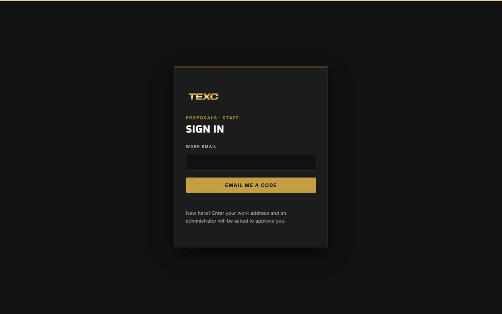

### Who can do what

| | Viewer | Editor | Administrator |
|---|---|---|---|
| See the dashboard and every proposal's history | Yes | Yes | Yes |
| Build, publish and archive proposals; export the list | | Yes | Yes |
| Copy a client's link | | Yes | Yes |
| Publish blast parameters; unlock a safety line | | | Yes |
| Withdraw; new link and passphrase; show the passphrase | | | Yes |
| Release a document the check did not pass | | | Yes |
| Record an acceptance received by email or on paper | | | Yes |
| Approve people; mark a proposal as practice | | | Yes |
| Add to, approve and retire the document library | | | Yes |
| Search the archive; open any revision as it was sent | Yes | Yes | Yes |
| Download a proposal's record pack | | Yes | Yes |
| Enter the keeping periods, as TEXC directs | | | Yes |

Brand in Black's accounts sit above these, for support. Only Brand in Black
can delete a proposal permanently (section 12).

## 3. The dashboard

Signing in lands here.

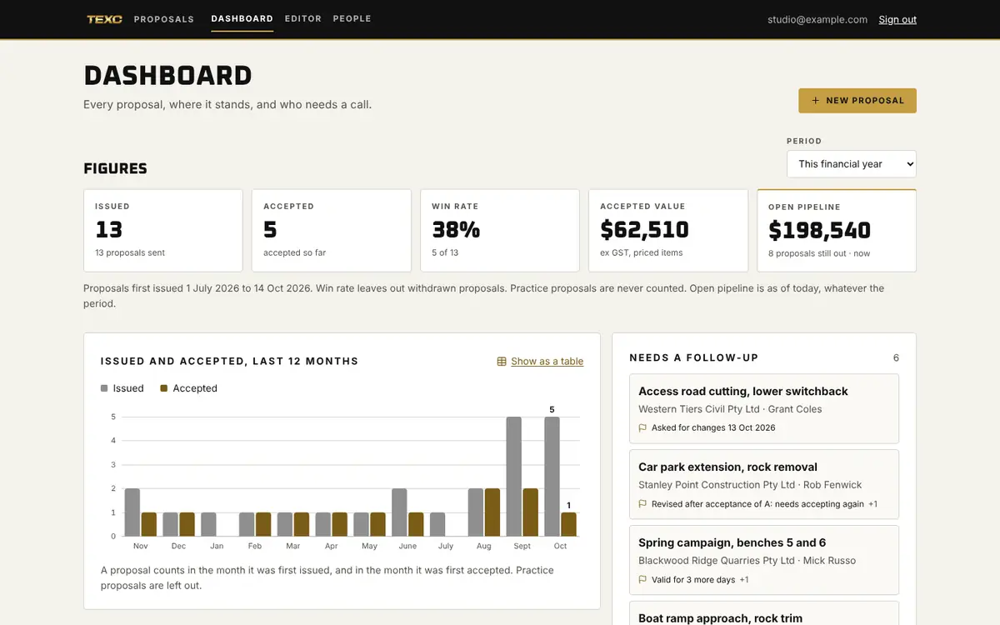

- **Figures** for a period (this financial year unless you choose another):
  how many proposals went out, how many were accepted, the win rate, what the
  accepted ones were worth, and what is still out with clients (the open
  pipeline, always as of today). Values are ex GST and count priced items
  only. Practice proposals never count.
- **Issued and accepted, last 12 months.** Hover over or tab to a month for
  its numbers, or show them as a table.
- **Needs a follow-up**, most pressing first: changes asked for; revised
  after acceptance and not accepted again; valid for 7 days or fewer; not
  opened 5 days after it was sent; opened, then quiet for 3 days.
- **Proposals**: every proposal, with search (client, project, place,
  reference, contact, service) and filters. **Export CSV** downloads the list
  as filtered, for Excel. Each export is recorded.

Click a proposal for its whole story: when it was published, emailed and
opened (and on what kind of device), which documents were opened, what the
client asked to change, and who accepted it.

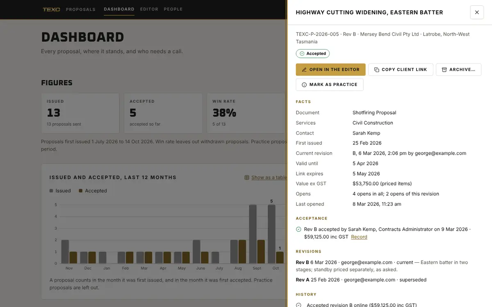

## 4. Starting a proposal

**New proposal** on the dashboard, or **Menu → New proposal** in the editor.
The proposal fills the screen; the editor is a drawer on the left. On a phone
it is a full-screen sheet, with **Edit** and **Preview** at the foot.

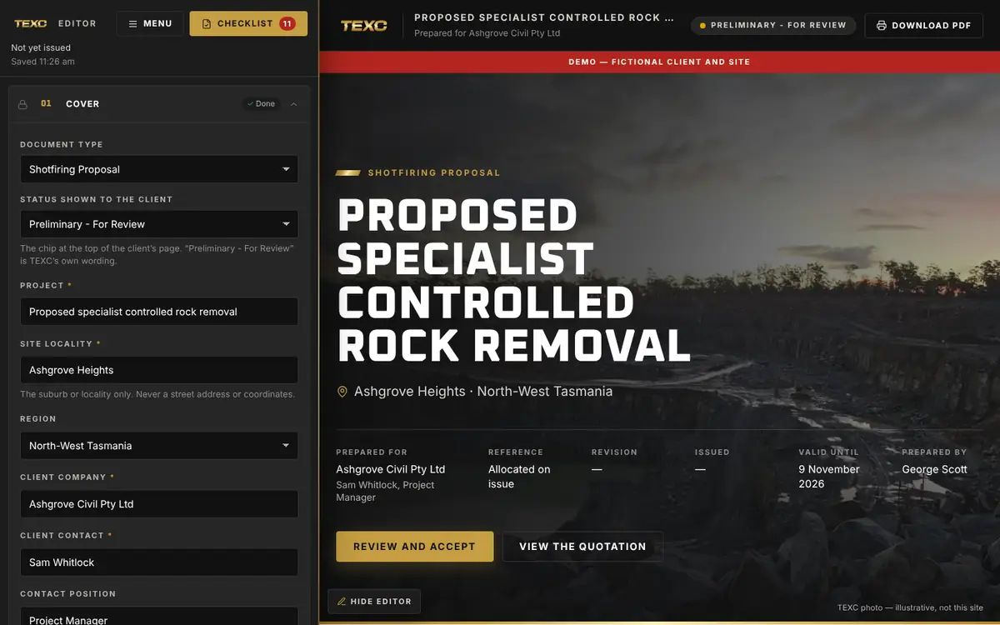

The drawer has a panel for each section of the proposal. Each panel can be
shown or hidden and moved up or down (drag it, or Alt + arrow keys). A badge
says what still needs doing in it. Everything you type appears on the page
straight away.

Your work saves itself every few seconds. If a colleague saved the same
proposal after you opened it, you are asked whether to load theirs or keep
yours; nothing is overwritten without asking. If the connection drops, your
changes are kept in the browser until they reach the server.

## 5. Filling it in

- **Cover.** Project, site (suburb or locality only — never a street address
  or coordinates), client, contact, valid-until date, cover photograph. The
  client's email is used only to send them the link.
- **Covering letter, About, Project understanding.** About uses the
  website's wording, word for word.
- **Scope of works.** Choose the services. Each brings its description from
  the website, and its safety line, which is locked: only an administrator can
  unlock or reword one, and that is recorded. Remote Area and Marine & Coastal
  are not offered.
- **Site details, Proposed work process, Environment, Safety and risk.** The
  library has the Chalmers Lane wording to start from (**Insert from
  library**). Every insert must be checked and acknowledged before
  publishing: that wording was written for one site.
- **Preliminary blast parameters** are off by default and only an
  administrator can publish them.
- **Explosives logistics and security** takes only the approved general
  lines, never free text: no magazine locations, routes, quantities or
  vehicles, ever.
- **Documentation, Personnel, Programme.**
- **Quotation.** Lines with a basis (hourly, daily, lump sum, at cost…),
  quantity and rate; optional items the client can tick. GST is added once,
  on the subtotal.
- **Documents and attachments** (section 7).
- **Terms, Acceptance.** Choose whether the client signs by drawing, typing
  their name, or either.

**A red CONFIRM tag** marks something TEXC has not yet confirmed: a rate, a
hazard control, a wording. It never shows to a client, and a proposal with
one in a section the client will see cannot be published.

**Warnings about sensitive text** (coordinates, magazines, quantities near
explosives words, routes) never block you, but each must be acknowledged.

## 6. Photographs

Choose a photograph in the panel; it is resized and its location data is
removed in your browser before it is stored. Every photograph needs a
description for people who cannot see it. Use TEXC's own photographs only.

## 7. Documents (PDFs)

Attach a PDF to each document card, or drop several PDFs on the panel at
once: each becomes a card, titled from its file name. A PDF dropped on a
card attaches to it. Each file is checked for anything that could run on the
client's computer (scripts, embedded files, launch actions).

- **Passed the check**: ready to send.
- **Refused by the check**: it carries active content. TEXC's own suite PDFs
  carry calculation scripts and are always refused as issued. Attach a
  **flattened copy** instead: open the PDF and print it to PDF (Acrobat,
  Preview or Chrome). It keeps every page and looks the same.
- **Could not be verified**: part of it could not be read. Try a fresh copy
  (print it to PDF).
- An administrator can release a refused or unverified file with a reason,
  which is recorded.

Up to 20 documents per proposal, 25 MB each. **Preview** shows it exactly as
the client will.

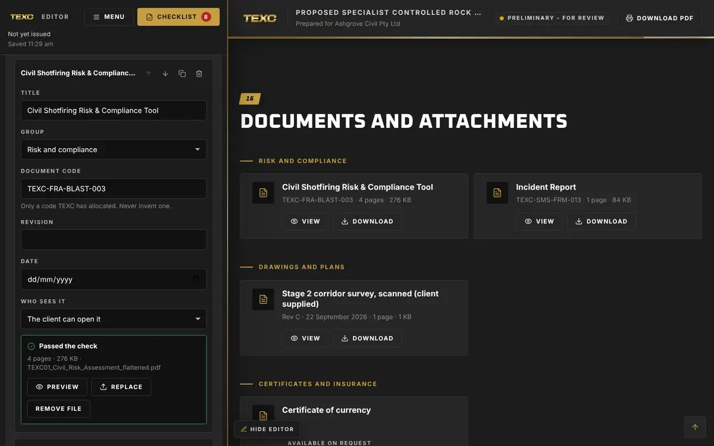

### The document library

Some documents go with many proposals: certificates of currency, licences,
the company's procedures and SWMS. Keep each once on the **Documents** page
(in the bar at the top of the dashboard) rather than attaching it to every
proposal.

- An administrator adds a document: whose it is (the company, or a person),
  what kind, its title, who issued it and its number. Then uploads its PDF,
  gives the facts printed on it (revision, dates, expiry) and approves it.
  It is checked like any other file.
- On a proposal, use **Choose from the library** on a document card.
  Publishing sends the library's current approved file, with its revision
  and expiry ("Current to 30 June 2027").
- When a certificate is renewed, upload the new one to the same document and
  approve it. Proposals send it from their next revision; ones already sent
  keep the one they sent.
- **Needs attention** lists what has expired, what lapses within 60 days and
  files waiting for approval. A proposal cannot be published with an expired
  library document, and the checklist asks you to acknowledge one that lapses
  before the proposal's valid-until date. The dashboard follows up a proposal
  whose certificate is about to lapse.
- A document no longer used is **retired**, not deleted: revisions that sent
  it still open it.

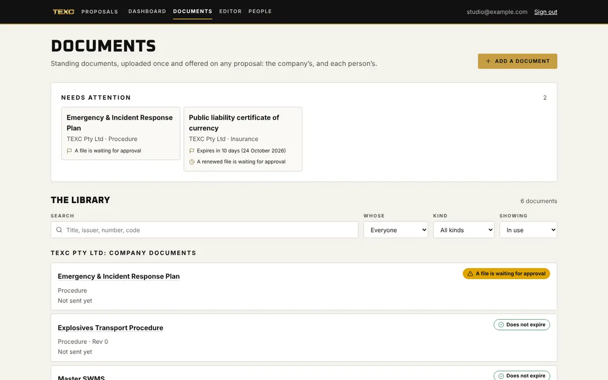

## 8. Publishing

Open the **Checklist**. It lists what must be done before publishing and
anything to acknowledge. It also shows what the client will see changed
since the last revision.

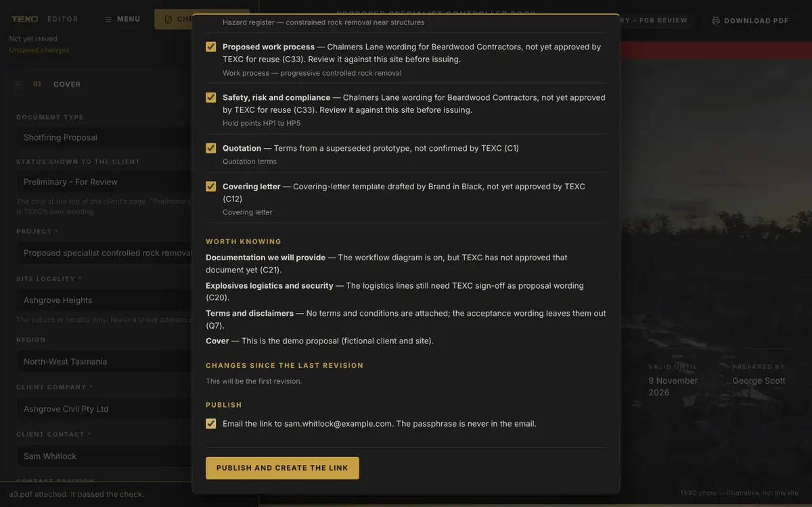

**Publish** creates the revision. The first time, you are shown:

- **the link**, which you can email to the client from the same dialog
  (the email never contains the passphrase);
- **the passphrase**, shown this once. Give it to the client by phone or
  text message, never in the same email as the link.

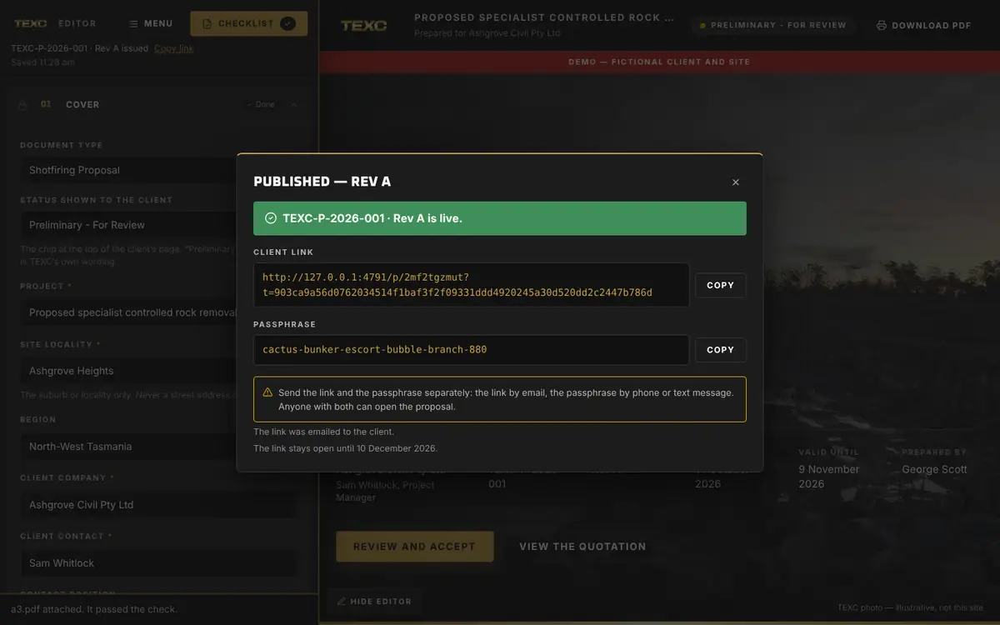

An administrator can show the passphrase again later (**Menu → Show the
passphrase**); that is recorded.

**Publishing again** makes Revision B, then C, behind the same link and
passphrase. The client always opens the latest. Earlier revisions stay
readable, marked as replaced.

## 9. What the client sees

The client opens the link, enters the passphrase and reads the proposal.
They can open the documents, tick optional items (the total updates), print
or save it as a PDF, ask for changes, or accept.

To accept they give their name, position, company and email, tick that they
have authority and that they accept, and sign. TEXC is emailed at once, and
so are they.

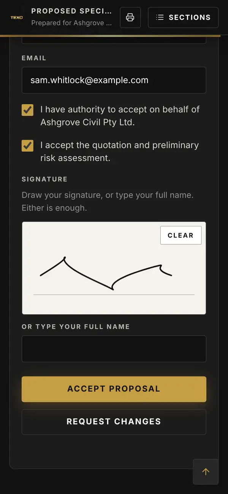

**After acceptance** the editor shows who accepted and when, with a link to
the stored **acceptance record** (printable). If you publish a new revision
of an accepted proposal, the checklist asks you to acknowledge that the
client will have to accept again, and the dashboard follows it up.

**Accepted another way** (a signed copy, an email)? An administrator records
it: **Menu → Record an acceptance received another way**, with a note saying
how it came. It cannot be undone.

## 10. Following up

The dashboard's **Needs a follow-up** list is the daily call list. TEXC is
also emailed when a client first opens a proposal, accepts it, or asks for
changes.

## 11. Taking a proposal back

- **Withdraw** (administrator, Menu): the link stops opening for the client.
  Publishing again later issues it behind a **new** link and passphrase.
- **New link and passphrase** (administrator, Menu): for a link sent to the
  wrong person or a lost passphrase. The old link stops working immediately.

## 12. Archive, restore and deleting for good

**Archive** (dashboard or editor menu) files a proposal away with a reason:
the client did not go ahead, the work was awarded to someone else, it was
completed, it was a duplicate. It is not withdrawn and nothing is deleted.
While it is archived its client link does not open, it leaves the editor's
list, and nothing can be changed on it. **Restore** brings all of that back.

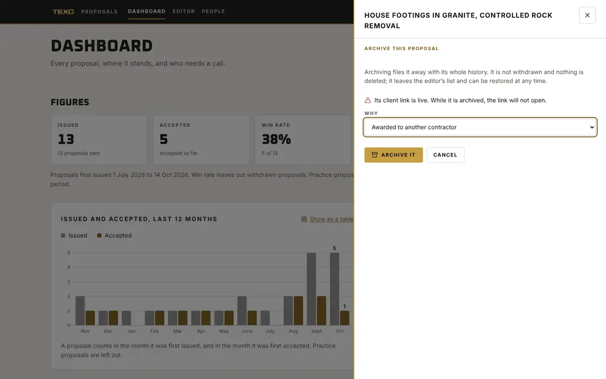

**Practice proposals** (administrator): mark a proposal you made for
practice or testing so it never counts in the figures.

**Deleting for good** is for Brand in Black only, 90 days after a proposal
was archived. An accepted proposal is a business record: it can be deleted
only once its keeping period (section 13) has passed since it was accepted,
and never while no period is set. Deleting removes every revision, its
history, photographs and documents. The staff audit keeps a note of what it
was and who deleted it.

## 13. The archive and record packs

The **Archive** page (in the bar at the top) lists every revision ever sent,
archived proposals included, newest first. Search by the client, the site, a
service, the reference, or a document's code or title — a drawing number
finds the revision that sent that drawing — and narrow it by the year it was
sent, the service or the region.

- **Open as sent** shows a revision exactly as the client received it, with
  the documents it sent, even if a later revision changed them. A strip at
  the top says when it was sent and what has happened since. Nothing you do
  there reaches the client.
- **Record pack** (editors and administrators) downloads one proposal's
  whole record as a zip: every revision as published, a copy of each you can
  read without this system, every document, the acceptance record with its
  signature, and every event. Each is checked against the fingerprint taken
  when it was published or accepted, and the pack says so on its first page.
  If anything does not match, the pack still downloads and names it: tell
  Brand in Black. Taking a pack is recorded.
- **Keeping periods** are TEXC's decision, not the system's. Until they are
  entered, nothing is archived automatically and no accepted proposal can be
  deleted. Once an administrator enters them, a proposal that ran out without
  being accepted is archived automatically after that many days (never
  deleted), and an accepted one is kept that many years.

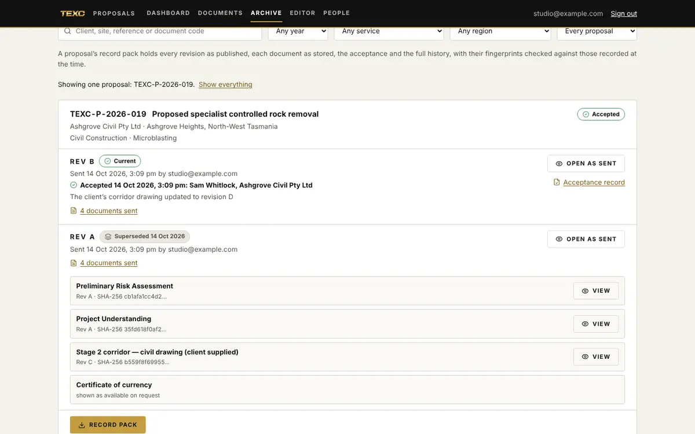

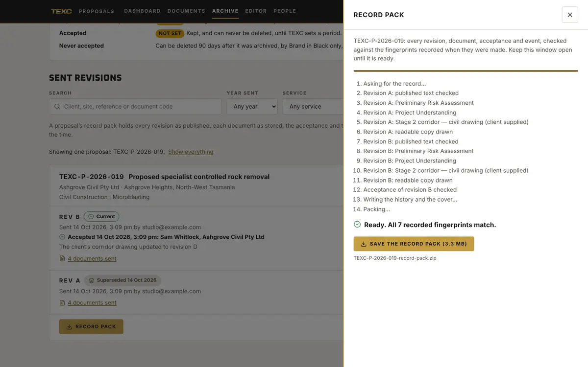

## 14. When something goes wrong

| What happened | What to do |
|---|---|
| "Someone else saved this proposal" | Choose whose version to keep. Talk to them first. |
| The client says the link does not work | It may have expired, been withdrawn or archived, or be incomplete. Check the dashboard; if needed, make a new link and passphrase. |
| The client lost the passphrase | An administrator can show it again (recorded), or make a new link and passphrase. |
| A document will not pass the check | Attach a flattened copy (print it to PDF). |
| A mistake in a proposal that was already sent | Fix it and publish again. The client sees the new revision; the old one is kept as it was. |
| Something else | Call Brand in Black. |
